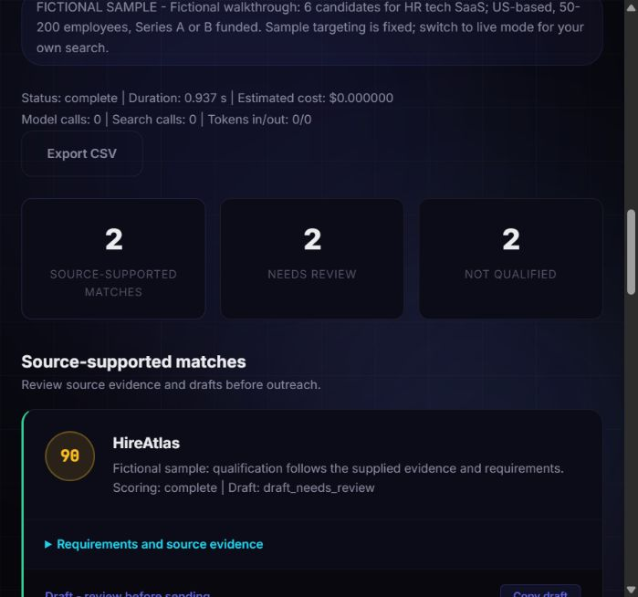

# LeadFlow AI

A source-backed company research and outreach drafting app built with FastAPI, LangGraph, Tavily, and Groq. Discover candidates, inspect the evidence behind their qualification, and review personalized drafts.

This is a fixed four-stage AI workflow. It does not find verified recipient addresses or send emails.



## Run the sample without API keys

Use Python 3.12 or 3.13. Node 22+ is only needed for frontend tests.

Windows PowerShell:

```powershell
python -m venv .venv
.\.venv\Scripts\python.exe -m pip install --upgrade pip
.\.venv\Scripts\python.exe -m pip install -r requirements.lock
.\.venv\Scripts\python.exe app.py
```

macOS / Linux:

```bash
python3 -m venv .venv
.venv/bin/python -m pip install --upgrade pip
.venv/bin/python -m pip install -r requirements.lock
.venv/bin/python app.py
```

Open [localhost](http://127.0.0.1:8000) and click **Try fictional sample**. The six sample companies, sources, labels and draft examples are fictional. Sample targeting is fixed to HR tech SaaS in the US, 50-200 employees, Series A or B. Changing your pitch changes the sample drafts. Sample mode makes zero provider calls and costs $0.

## Enable live research

Copy `.env.example` to `.env` only if you do not already have a populated `.env`. Preserve existing secrets.

Set `GROQ_API_KEY`, `TAVILY_API_KEY`, and a long random `APP_ACCESS_TOKEN`. Generate a token locally:

```bash
python -c "import secrets; print(secrets.token_urlsafe(32))"
```

Restart the server, choose **Live research**, and enter that access token. It stays in page memory and is not included in saved runs. All three settings are required to enable live runs. The model is configurable with `GROQ_MODEL`; confirm that your provider account supports it.

The browser submits industry, the full ICP, up to eight extra must-match requirements, a sender offer, and 1-20 desired candidates. Discovery can return fewer candidates. LinkedIn/Crunchbase profiles remain profile URLs; the app does not guess their company domains or scrape directory homepages as company evidence.

## How qualification works

- Search snippets and company pages are saved with their source URL and retrieval timestamp.
- The model assesses industry, the complete ICP, and every additional requirement.
- Every match or contradiction must cite an exact quote present in the retrieved text.
- **Source-supported match:** all requirements have cited matches and the validated score is at least 60.
- **Needs review:** missing evidence, invalid scoring, or a score below 60 without a cited contradiction. Unknown evidence caps the score at 59.
- **Not qualified:** at least one cited contradiction. The score is capped at 39.
- Industry, location, employee count and funding show a source-supported value or **unknown**.
- Only qualified leads receive drafts. Your actual offer is used. All drafts require human review.

An exact quote establishes what a source says. It does not independently establish truth, company identity, freshness, or semantic correctness. Prompt injection and incorrect model interpretation remain possible; review the evidence before outreach.

## Saved runs and exports

Completed, partial, and failed-search reports are saved in SQLite. A random HttpOnly, SameSite=Strict cookie limits history, reading, export, and deletion to that browser session. Clearing cookies loses access. An access token alone cannot retrieve someone else's saved runs.

Retention is up to seven days, with at most 50 reports per session and 500 globally. The default database is `data/runs.sqlite3`; override it with `LEADFLOW_DB`. The database contains your pitch, targeting and retrieved company information, so keep it private. No provider keys or live access tokens are saved in reports.

CSV export includes evidence, facts and criteria, and escapes spreadsheet formula prefixes. You can delete a saved report from history.

## Limits and deployment

Default protections:

- No paid runs without the configured live access token.
- Two simultaneous workers per process; 240-second cooperative run deadline.
- Ten starts per session per rolling hour, 30 per client IP per rolling hour, and `MAX_LIVE_RUNS_PER_DAY` live starts per rolling 24 hours (default 50).
- Shared live budget is transactional in SQLite. Failed/cancelled starts still consume quota.
- Input size limits, safe text rendering, same-origin mutation checks and security headers.
- Scraping permits only public HTTP(S) addresses on standard ports, validates all DNS answers and redirects, and connects to the validated IP with TLS hostname verification.
- Scraping limits redirects, time and bytes, rejects compressed responses, and does not use environment HTTP proxies.
- Disconnecting cancels future work. An in-flight network request may finish before cancellation is observed. DNS resolver delays can outlive the cooperative deadline.

Run **one Uvicorn worker** for this version. The concurrency semaphore is process-local. Use the default loopback binding for local work. For an internet-facing deployment, put it behind HTTPS and an authenticated reverse proxy with request/time/rate limits, set `COOKIE_SECURE=true`, and restrict outbound networking at the infrastructure layer. Do not distribute the live access token to anonymous demo visitors. Proxy clients share the proxy IP quota unless you add a trusted-proxy design; arbitrary forwarded headers are deliberately ignored.

This remains a small single-instance app, not a multi-tenant SaaS deployment.

## Usage and cost

Each report records wall time, stage durations, model/search calls, reported search credits, and input/output tokens. Add your own plan rates to `.env` to calculate estimated total cost and cost per qualified lead:

- `GROQ_INPUT_USD_PER_MILLION`
- `GROQ_OUTPUT_USD_PER_MILLION`
- `TAVILY_USD_PER_CREDIT`

Blank rates mean **unavailable**, not zero. Estimates are not invoices: failed requests and unreported usage may be excluded. Sample mode always records zero API usage.

## Tests, evaluation and dependency checks

```powershell
.\.venv\Scripts\python.exe -m pip install -r requirements-dev.txt
.\.venv\Scripts\python.exe -m unittest discover -s tests -v
node --test tests/frontend.test.cjs
.\.venv\Scripts\python.exe -m evals.evaluate
.\.venv\Scripts\python.exe -m scripts.benchmark
.\.venv\Scripts\python.exe -m pip_audit -r requirements.lock --disable-pip --no-deps --strict
```

Use `.venv/bin/python` instead on macOS/Linux.

The default evaluation uses six manually labelled fictional cases and supplied model assessments to check the qualification rules. Its accuracy, precision and recall describe **policy regression**, not live model performance. To evaluate your configured model against the same fixed evidence, explicitly opt into a paid model evaluation:

```bash
python -m evals.evaluate --live --output evals/live-results.json
```

This uses Groq credits, does not search/scrape, and does not measure real-world discovery quality. Expand the labelled dataset with genuine, permissioned source snapshots before making portfolio accuracy claims. `test_groq.py` is also an explicitly invoked live smoke check; importing it never calls the API.

CI runs backend/frontend tests, the offline evaluation, and the lockfile advisory scan on Python 3.12 and 3.13. It requires no API secrets. Refresh dependency pins and the complete lock together, then rerun tests and the scan. An audit only covers advisories known at scan time.

## Architecture and portfolio notes

See [architecture](docs/architecture.md), [security boundaries](docs/security.md), and [verification results](docs/verification.md).

A useful portfolio description:

> Built an evidence-backed lead research workflow using FastAPI and LangGraph, with streamed progress, exact-quote validation, conservative qualification, isolated execution, session-owned reports, CSV export, and automated security regressions.

Describe measured live results separately from fictional walkthroughs. Strong next steps are a larger real-world evaluation set, verified company-domain resolution, configurable human review, and durable job workers before horizontal scaling.

MIT licensed; see [LICENSE](LICENSE).
