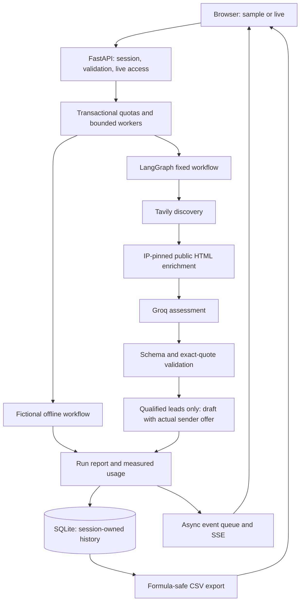

# Architecture

## Boundaries and state

`AgentState.leads` is replaced by each sequential stage. There is no merging reducer to reintroduce duplicates or undo score sorting. Search identifies direct websites by normalized hostname and directory profiles by profile path. It keeps source snapshots rather than treating a directory profile as a company homepage.

A worker sets a ContextVar containing its own cancellation event, bounded-event emitter, deadline and usage counters. Provider tools check this context before scheduling more work. Stage wrappers emit explicit events and timings. No code captures global stdout.

The ASGI event stream waits on an asyncio queue, so an idle stream does not block the event loop. The worker performs synchronous provider and database work outside that loop. Disconnect and deadline checks stop subsequent operations; this is cooperative cancellation, not forced interruption of threads.

## Evidence contract

The scorer receives source snapshots and requirement IDs. A strict Pydantic schema bounds the score and requires one assessment per requested ID. Application code rejects missing/duplicate IDs, invalid source references and invented quotes. Unsupported verdicts become unknown. Qualification is decided in application code. Facts need a literal value in their validated citation.

This validates structural provenance. It cannot prove that a quote entails the verdict, that the publisher is truthful, or that the profile belongs to the intended entity. The UI exposes this distinction.

## Persistence

SQLite stores hashed session capabilities, report JSON, and start-budget events. Ownership predicates are used for listing, reading, export and deletion. Raw cookie capabilities and live access tokens are not stored. SQL uses bound parameters. Connections commit/rollback and close explicitly.

History is bounded by age and count. Cleanup runs during session creation and report writes. Expired history is hidden from reads immediately, even before physical cleanup.

## Scaling path

The present deployment uses one server process and two worker threads. Before multiple processes or hosts, move jobs, cancellation, concurrency limits, sessions and quotas to shared infrastructure; add authenticated user identities and owner-scoped queues. Keep the same evidence contract and regression tests.
